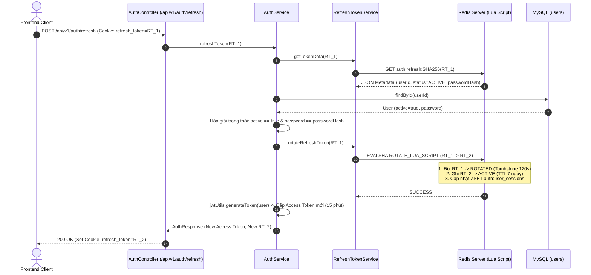
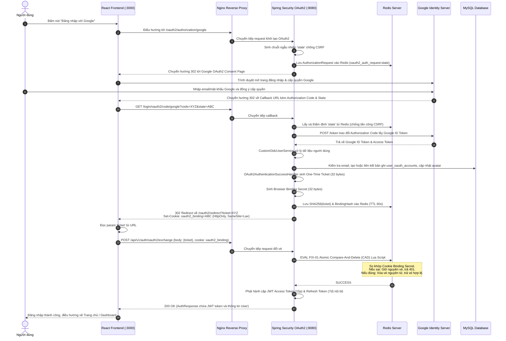
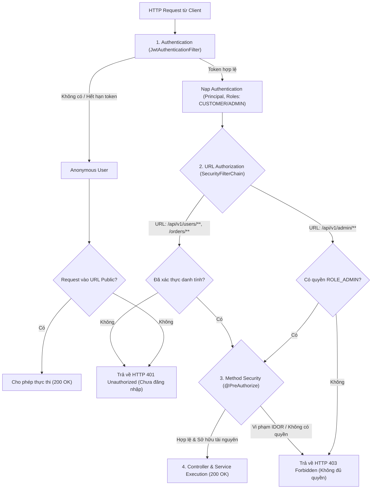
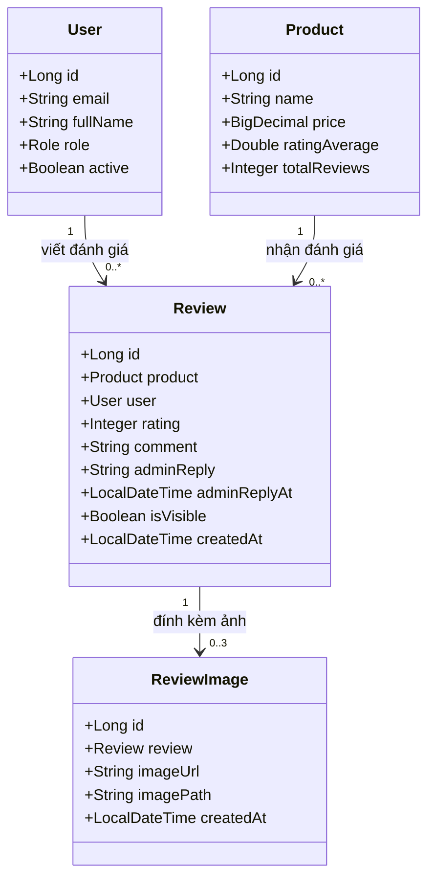

# 🏛️ BÁO CÁO KIẾN TRÚC KỸ THUẬT, BẢO MẬT & MÔ HÌNH HỆ THỐNG (TSK-D17-CCT)
## DỰ ÁN: RIKKEI ECOMMERCE PLATFORM (B2C OMNI-CHANNEL PLATFORM)

> **Kỹ sư phụ trách:** Cao Chí Thiện (CCT)  
> **Vai trò:** Senior Software Architect, Technical Lead & Application Security Engineer  
> **Mã nhiệm vụ:** `TSK-D17-CCT`  
> **Thời điểm thẩm định & nghiệm thu:** 17/11/2026  
> **Môi trường kỹ thuật:** Java 21 LTS, Spring Boot 3.3.5, Spring Security 6.3.4, React 18, MySQL 8.0, Redis 7.0, Nginx, Docker Compose.

---

## 📑 MỤC LỤC BÁO CÁO
1. [Phần A — Khảo Sát & Đối Chiếu Kiến Trúc Thực Tế](#phần-a--khảo-sát--đối-chiếu-kiến-trúc-thực-tế)
2. [Phần B — Kiến Trúc Tổng Thể Client–Server & Luồng Giao Tiếp](#phần-b--kiến-trúc-tổng-thể-clientserver--luồng-giao-tiếp)
3. [Phần C — Kiến Trúc Xác Thực JWT & Quản Lý Phiên Bằng Redis](#phần-c--kiến-trúc-xác-thực-jwt--quản-lý-phiên-bằng-redis)
4. [Phần D — Kiến Trúc Đăng Nhập Nhanh Google OAuth2 & OpenID Connect](#phần-d--kiến-trúc-đăng-nhập-nhanh-google-oauth2--openid-connect)
5. [Phần E — Mô Hình Phân Quyền RBAC & Quản Trị Đánh Giá Sản Phẩm](#phần-e--mô-hình-phân-quyền-rbac--quản-trị-đánh-giá-sản-phẩm)
6. [Phần F — Tổng Hợp Các Cơ Chế An Toàn Thông Tin & Ma Trận Phòng Thủ](#phần-f--tổng-hợp-các-cơ-chế-an-toàn-thông-tin--ma-trận-phòng-thủ)
7. [Mô Hình Dữ Liệu Thực Thể Quan Hệ (ERD Chuẩn CSDL MySQL)](#mô-hình-dữ-liệu-thực-thể-quan-hệ-erd-chuẩn-csdl-mysql)

---

## PHẦN A — KHẢO SÁT & ĐỐI CHIẾU KIẾN TRÚC THỰC TẾ

Sau quá trình rà soát toàn diện mã nguồn, cấu hình hệ thống (`build.gradle`, `package.json`, `application.yml`, `docker-compose.yml`) và 1,068 bài kiểm thử tự động, dưới đây là bảng đối chiếu công nghệ và trạng thái triển khai thực tế:

| Thành phần hệ thống | Công nghệ / Thư viện thực tế | Phiên bản | Vai trò & Trách nhiệm kiến trúc | Trạng thái xác minh | Bằng chứng mã nguồn / Kiểm thử |
|:---|:---|:---:|:---|:---:|:---|
| **Frontend Framework** | React + Vite | 18.3.1 / 5.4.10 | Giao diện người dùng Single Page Application (SPA), quản lý route, state cart và render DOM. | **ĐÃ TRIỂN KHAI** | `frontend/package.json`, `src/App.jsx`, `src/context/` |
| **Frontend Styling** | Tailwind CSS + Framer Motion | 3.4.14 / 11.11 | Hệ thống giao diện responsive (Desktop, Tablet, Mobile 375px), hiệu ứng tương tác trực quan. | **ĐÃ TRIỂN KHAI** | `tailwind.config.js`, `ProductReviewsSection.jsx` |
| **Frontend OAuth2 SDK** | `@auth0/auth0-react` | 2.30.0 | Thực thi luồng Authorization Code Flow with PKCE đăng nhập Google phía client. | **ĐÃ TRIỂN KHAI** | `frontend/src/main.jsx`, `frontend/src/pages/auth/LoginPage.jsx` |
| **Backend Runtime** | Java OpenJDK | 21 LTS | Nền tảng thực thi chính, tận dụng Virtual Threads và tính năng ngôn ngữ Java 21 hiện đại. | **ĐÃ TRIỂN KHAI** | `backend/build.gradle` (`JavaLanguageVersion.of(21)`) |
| **Backend Framework** | Spring Boot | 3.3.5 | Core Web MVC, Dependency Injection, Transaction Management, Exception Handling. | **ĐÃ TRIỂN KHAI** | `backend/build.gradle` (`org.springframework.boot:3.3.5`) |
| **Security Framework** | Spring Security | 6.3.4 | Chuỗi lọc `SecurityFilterChain`, Method Security `@PreAuthorize`, Authentication Manager. | **ĐÃ TRIỂN KHAI** | `config/SecurityConfig.java`, `SecurityConfigTest.java` |
| **Stateless Auth Token** | JJWT (io.jsonwebtoken) | 0.12.6 | Tạo, ký số HMAC-SHA256 và thẩm định Access Token 15 phút. | **ĐÃ TRIỂN KHAI** | `security/JwtUtils.java`, `JwtUtilsTest.java` |
| **Distributed Cache & State**| Redis 7.0 (Spring Data Redis) | 7.0 Alpine | Lưu trữ Opaque Refresh Token (SHA-256), Sorted Sets danh bạ phiên, Token Rotation, OTP, Chat Memory. | **ĐÃ TRIỂN KHAI** | `service/RefreshTokenService.java`, `RefreshTokenServiceTest.java` |
| **Rate Limiter** | Bucket4j Lettuce CAS | 8.14.0 | Kiểm soát tần suất phân tán (10 req/60s/IP) cho API Chatbot và chống brute-force. | **ĐÃ TRIỂN KHAI** | `chat/config/RateLimitConfig.java`, `RedisRateLimiterServiceImpl.java` |
| **Trí Tuệ Nhân Tạo (AI)** | Spring AI + Google Gemini | 1.0.0-M4 | Client OpenAI-compatible gọi mô hình Gemini 2.5 Flash, Tool Calling (Product/Order/Stock). | **ĐÃ TRIỂN KHAI** | `chat/service/impl/ChatServiceImpl.java`, `ProductTools.java` |
| **Cơ sở Dữ liệu Quan hệ** | MySQL Server | 8.0 | Lưu trữ 14 bảng quan hệ ACID, chuẩn InnoDB, `utf8mb4_unicode_ci`, Foreign Keys CASCADE. | **ĐÃ TRIỂN KHAI** | `database/init/01-schema.sql`, `02-sample-data.sql` |
| **Cổng Thanh toán Online** | VNPay Sandbox Protocol | 2.1.0 | Khởi tạo URL VNPAY-QR, tiếp nhận Webhook IPN Server-to-Server, HMAC-SHA512. | **ĐÃ TRIỂN KHAI** | `service/PaymentService.java`, `util/VNPayUtil.java` |
| **Reverse Proxy & Gateway** | Nginx | Alpine | Reverse Proxy cổng 3000 $\rightarrow$ 8080, phục vụ tĩnh `/uploads/`, chuyển tiếp client IP header. | **ĐÃ TRIỂN KHAI** | `frontend/nginx.conf`, `docker-compose.yml` |
| **Email Service** | Spring Mail (JavaMailSender) | 3.3.5 | Gửi OTP 6 chữ số qua SMTP STARTTLS/SSL (hỗ trợ Brevo, Resend, Gmail). | **ĐÃ TRIỂN KHAI** | `service/impl/EmailServiceImpl.java`, `EmailServiceTest.java` |
| **File Storage** | Local File Storage | Native Disk | Lưu trữ ảnh đánh giá tại `uploads/reviews/`, kiểm tra Magic Bytes, chống Decompression Bomb. | **ĐÃ TRIỂN KHAI** | `service/FileStorageService.java`, `ReviewImageController.java` |
| **Tài khoản ROLE_SELLER** | Multi-vendor Marketplace | N/A | Mô hình nhiều người bán hàng cùng đăng ký gian hàng và quản lý shop riêng. | **CHƯA TRIỂN KHAI** | Mã nguồn chỉ có `CUSTOMER` và `ADMIN` (Mô hình B2C đơn sàn). |
| **Dịch vụ Cloudinary** | Cloudinary Image Hosting | N/A | Dịch vụ lưu trữ đám mây cho hình ảnh tải lên của người dùng. | **CHƯA TRIỂN KHAI** | Không sử dụng theo nguyên tắc bảo vệ quyền tự chủ dữ liệu nội bộ. |

---

## PHẦN B — KIẾN TRÚC TỔNG THỂ CLIENT–SERVER & LUỒNG GIAO TIẾP

### 1. Sơ đồ Kiến trúc 11 Thành phần Hệ thống

```mermaid
graph TD
    subgraph UsersLayer["1. Người Dùng & Quản Trị Viên (Actors)"]
        CustomerUser["Khách Hàng (Customer / Guest)"]
        AdminUser["Quản Trị Viên (System Admin)"]
    end

    subgraph ClientLayer["2. Giao Diện Người Dùng (Client Layer)"]
        ReactApp["React 18 SPA (Vite + TailwindCSS + Zustand)<br/>- Router: react-router-dom 6<br/>- HTTP Client: Axios 1.7 Interceptors<br/>- Auth0 React SDK"]
    end

    subgraph ProxyLayer["3. Cổng Đảo Chiều & Định Tuyến (Reverse Proxy)"]
        NginxServer["Nginx Reverse Proxy (:3000)<br/>- Định tuyến API: /api/v1 -> Backend:8080<br/>- Phục vụ Static: /uploads -> /var/www/uploads<br/>- Gán Headers: X-Forwarded-For, X-Real-IP"]
    end

    subgraph BackendGateway["4. Cổng Tiếp Nhận & Bộ Lọc An Ninh (Spring Security)"]
        RateLimit["Rate Limiter (Bucket4j Lettuce CAS: 10 req/60s/IP)"]
        CorsFilter["CorsConfigurationSource (Whitelist Domains)"]
        SecFilterChain["Spring Security Filter Chain (Stateless, CSRF Disabled)"]
        JwtFilter["JwtAuthenticationFilter (HMAC-SHA256, UserDetails)"]
    end

    subgraph BackendCore["5. Xử Lý Nghiệp Vụ & Dịch Vụ (Backend Core)"]
        Controllers["Controllers (Auth, User, Chat, Order, Payment, Review)"]
        Services["Services (AuthService, RefreshTokenService, PaymentService, etc.)"]
        Tools["Spring AI Function Calling Tools (Product, Order, Inventory)"]
    end

    subgraph PersistenceLayer["6. Tầng Dữ Liệu & Bộ Nhớ Đệm (Persistence Layer)"]
        MySQLDB[("MySQL 8.0 Database (:3306)<br/>- 14 Bảng dữ liệu InnoDB<br/>- Foreign Keys CASCADE<br/>- Khóa bi quan Pessimistic Write")]
        RedisCache[("Redis 7.0 Server (:6379)<br/>- Opaque RT Hash: auth:refresh:<hash><br/>- ZSET Phiên: auth:user_sessions:<uid><br/>- Lua Scripts: Token Rotation & OTP Verify")]
        LocalStorage[("Local Disk Storage (/uploads)<br/>- uploads/reviews/ (Magic Bytes, < 5MB)<br/>- Hook: afterCommit Cleanup")]
    end

    subgraph ExternalServices["7. Dịch Vụ Bên Ngoài (Third-Party Services)"]
        GoogleOAuth["Google Identity / Auth0 OIDC Server"]
        VNPayGateway["Cổng Thanh Toán VNPay Sandbox 2.1.0"]
        GeminiAPI["Google Gemini 2.5 Flash API (LLM)"]
        SMTPServer["Brevo / Resend SMTP Relay Server"]
    end

    CustomerUser -->|HTTPS| ReactApp
    AdminUser -->|HTTPS| ReactApp
    ReactApp -->|HTTP Port 3000| NginxServer
    NginxServer -->|Proxy Pass Port 8080| RateLimit
    RateLimit --> CorsFilter
    CorsFilter --> SecFilterChain
    SecFilterChain --> JwtFilter
    JwtFilter --> Controllers
    Controllers --> Services
    Services --> Tools
    Services --> MySQLDB
    Services --> RedisCache
    Services --> LocalStorage
    Services --> GoogleOAuth
    Services --> VNPayGateway
    Services --> GeminiAPI
    Services --> SMTPServer
```



### 2. Trách nhiệm Từng Thành phần & Giao thức Giao tiếp

1. **Client (Browser / React SPA):** Gửi HTTP REST request dạng JSON qua Axios. Quản lý Access Token trong bộ nhớ RAM ứng dụng (Zustand store) và tự động đính kèm cookie HttpOnly `refresh_token` khi gọi refresh.
2. **Nginx Reverse Proxy (:3000):** Đóng vai trò tấm khiên bảo vệ biên (Perimeter Gateway). Lắng nghe cổng 3000, phục vụ trực tiếp các file ảnh tĩnh trong thư mục `uploads/` mà không cần gọi vào Java, chuyển tiếp toàn bộ request `/api/v1/` sang Backend cổng 8080 kèm các header chuẩn `X-Forwarded-For` và `X-Real-IP`.
3. **Spring Security Filter Chain:** Hoạt động theo mô hình Stateless. Tắt CSRF vì không dùng session cookie truyền thống; kích hoạt CorsFilter tập trung; chặn mọi request vào `/api/v1/admin/**` nếu không có quyền `ROLE_ADMIN`; giải mã Bearer Token tại `JwtAuthenticationFilter`.
4. **Service Layer & Transaction Manager:** Thực thi nghiệp vụ thương mại điện tử, quản lý giao dịch CSDL với `@Transactional(rollbackFor = Exception.class)`, kích hoạt khóa bi quan (Pessimistic Lock) chống race condition tài chính và tồn kho.
5. **MySQL 8.0:** Lưu trữ dữ liệu bền vững (Persistent Data): Người dùng, sản phẩm, đơn hàng, thanh toán, đánh giá. Đảm bảo tính toàn vẹn thông qua khóa ngoại và ràng buộc duy nhất.
6. **Redis 7.0:** Lưu trữ dữ liệu phiên và bộ đệm tốc độ cao (In-memory State): Chỉ lưu chuỗi băm SHA-256 của Refresh Token, cấu trúc Sorted Set (ZSET) quản lý danh bạ phiên, bộ đếm Rate Limiting của Bucket4j, và lịch sử hội thoại Chatbot AI.

---

## PHẦN C — KIẾN TRÚC XÁC THỰC JWT & QUẢN LÝ PHIÊN BẰNG REDIS

### 1. Access Token (Stateless JWT)
- **Cơ chế ký số:** Sử dụng thư viện JJWT 0.12.6, thuật toán **HMAC-SHA256**. Khóa bí mật `jwt.secret` được nạp từ biến môi trường của hệ điều hành, bắt buộc độ dài $\ge 256$ bits ($\ge 32$ ký tự).
- **Các Claims thực tế:**
  ```json
  {
    "sub": "customer1@example.com",
    "email": "customer1@example.com",
    "userId": 15,
    "role": "ROLE_CUSTOMER",
    "iat": 1731800000,
    "exp": 1731800900
  }
  ```
- **Thời hạn hiệu lực:** **15 phút** (`900,000ms`). Hạn chế tối đa thời gian kẻ tấn công có thể lợi dụng nếu token bị lộ lọt.
- **Quy trình xác thực & Kiểm soát trạng thái khóa tại Backend:**
  - `JwtAuthenticationFilter` trích xuất chuỗi từ header `Authorization: Bearer <token>`. Gọi `jwtUtils.parseClaims(token)`.
  - Nếu chữ ký hợp lệ và chưa hết hạn, nạp `CustomUserDetails` từ CSDL qua `userDetailsService.loadUserByUsername(email)`.
  - Kiểm tra `userDetails.isEnabled()` (`user.getActive() == true`).
  - **Khóa tài khoản tức thì (Instant Lockout):** Khi Admin khóa tài khoản (`active = false`), ngay ở request tiếp theo, `userDetails.isEnabled()` trả về `false` khiến Filter không thiết lập `SecurityContext`, chặn đứng request ngay lập tức với HTTP 401/403 mà KHÔNG cần đợi token hết hạn 15 phút!
  - **Khi Đăng xuất (Logout):** Server thu hồi phiên trong Redis (`refreshTokenService.revokeToken`) và xóa HttpOnly Cookie. Access Token phía client bị hủy khỏi bộ nhớ RAM/Zustand và sẽ tự hết hạn sau tối đa 15 phút (Stateless). *(Cơ chế JTI Blacklist trên Redis là giải pháp mở rộng được đề xuất khi cần vô hiệu hóa Access Token tức thì khi logout).*

### 2. Opaque Refresh Token & Cookie HttpOnly
- **Bản chất Opaque Token:** Chuỗi ngẫu nhiên 64 bytes sinh bởi `SecureRandom` (CSPRNG), mã hóa Base64 URL-safe, hoàn toàn không chứa thông tin người dùng (không phải JWT).
- **Lưu trữ Redis:** **TUYỆT ĐỐI KHÔNG LƯU TOKEN THÔ**. Redis chỉ lưu mã băm **SHA-256** của Refresh Token tại khóa:
  $$\text{Key} = \text{auth:refresh:} + \text{SHA256}(\text{RawRefreshToken})$$
- **Truyền nhận an toàn:** Refresh Token được gửi về trình duyệt thông qua Cookie:
  ```http
  Set-Cookie: refresh_token=RT_xyz...; Path=/api/v1/auth; HttpOnly; SameSite=Lax; Max-Age=604800
  ```
  Thuộc tính `HttpOnly` ngăn chặn 100% việc mã độc JavaScript trên trình duyệt (XSS) đánh cắp token; `Path=/api/v1/auth` đảm bảo cookie chỉ được gửi đi khi gọi các endpoint xác thực.

### 3. Cơ Chế Xoay Vòng Token Nguyên Tử (Atomic Token Rotation) & Redis Lua Script
Thao tác xoay vòng được thực thi nguyên tử hoàn toàn bên trong Redis bằng Lua Script (`ROTATE_LUA_SCRIPT` tại [`RefreshTokenService.java`](file:///d:/Doanh%20nghiep/20-10-2026/Project-Rikkei-Ecommerce/backend/src/main/java/com/example/ecommerce/service/RefreshTokenService.java#L89-L106)):



### 4. Xử Lý Mạng Lag (Grace Period 10s) & Báo Động Tái Sử Dụng (Reuse Detection)
- **Thời gian ân hạn (Grace Period = 10 giây):** Nếu do mạng lag hoặc 2 tab trình duyệt cùng gửi request refresh với `RT_1` cũ trong vòng 10 giây kể từ khi token bị xoay (`rotatedAt`), hệ thống nhận diện đây là sự cố đường truyền mạng và **trả về an toàn token mới `RT_2`**, không ngắt kết nối của người dùng.
- **Phát hiện tái sử dụng Token (Reuse Detection):** Nếu `RT_1` cũ được gửi lên sau 10 giây, hệ thống kích hoạt cơ chế báo động đánh cắp tài khoản: Gọi Lua script `REVOKE_ALL_LUA_SCRIPT` xóa sạch toàn bộ các refresh token đang tồn tại trong Sorted Set `auth:user_sessions:<userId>`, buộc đăng xuất trên mọi thiết bị ngay lập tức!

### 5. Khảo Sát Chính Xác Mục Đích Sử Dụng Redis
| Khóa Redis (Key Pattern) | Cấu trúc dữ liệu | Mục đích sử dụng thực tế | Cơ chế dọn dẹp |
|---|---|---|---|
| `auth:refresh:<tokenHash>` | String (JSON) | Lưu metadata Refresh Token (status, familyId, expiresAt, passwordHash). | Hết hạn theo TTL (7 ngày / 120s tombstone). |
| `auth:user_sessions:<userId>` | Sorted Set (ZSET) | Quản lý danh bạ các phiên đăng nhập của người dùng (score là `expiresAt`). | `ZREMRANGEBYSCORE` mỗi khi tạo/xoay vòng token. |
| `auth:otp:<email>` | String | Lưu chuỗi băm HMAC-SHA256 của mã OTP 6 chữ số quên mật khẩu. | TTL 300 giây (5 phút) hoặc xóa ngay khi claim. |
| `auth:otp:ratelimit:<email>` | String | Giới hạn tần suất yêu cầu gửi lại mã OTP (tối thiểu 60s/lần). | TTL 60 giây. |
| `auth:oauth2_ticket:<ticketHash>` | String (JSON) | Lưu vé dùng một lần đổi token khi đăng nhập Google OAuth2 (bản vá FIX-01). | TTL 60 giây hoặc xóa nguyên tử sau khi đổi. |
| `oauth2_auth_request:<state>` | String (Base64) | Lưu tạm Authorization Request của Google OAuth2 thay cho session HTTP. | TTL 300 giây hoặc xóa khi Google callback. |
| `chat:rate-limit:ip:{<ip>}` | Byte[] (Bucket4j CAS) | Token Bucket kiểm soát tần suất chat (10 requests/60s/IP). | Expiration sau 10 phút không hoạt động. |
| `chat:lock:<sessionId>` | String | Khóa phân tán (Distributed Lock) chống race condition đa luồng gửi chat. | TTL 60 giây và giải phóng trong `finally` block. |
| `chat:session:<sessionId>:messages`| String (JSON) | Lưu trữ lịch sử hội thoại Chatbot AI (tối đa 20 messages gần nhất). | TTL 24h (Guest) hoặc 7 ngày (User). |

> [!IMPORTANT]
> **Khẳng định kiến trúc:** Redis **KHÔNG LƯU ACCESS TOKEN JWT**. JWT là hoàn toàn Stateless, server xác thực dựa trên chữ ký mật mã HMAC-SHA256 mà không tốn bất kỳ truy vấn I/O nào vào Redis.

---

## PHẦN D — KIẾN TRÚC ĐĂNG NHẬP NHANH GOOGLE OAUTH2 & OPENID CONNECT

Dự án triển khai kiến trúc đăng nhập Google hai luồng song song có tính sẵn sàng cao:
1. **Luồng Direct Google OAuth2:** Sử dụng Spring Security OAuth2 Client kết hợp cơ chế One-Time Ticket Exchange và bản vá `FIX-01` Atomic Compare-And-Delete.
2. **Luồng Auth0 Google PKCE:** Sử dụng SDK `@auth0/auth0-react` phía client và backend thẩm định JWT ID Token thông qua `NimbusJwtDecoder` với chữ ký bất đối xứng RS256.

### 1. Sơ đồ Tuần tự 12 Bước (Sequence Diagram) Luồng Direct Google OAuth2



### 2. Các Biện Pháp Bảo Mật Trọng Yếu Trong Luồng Google OAuth2
- **Authorization Code Flow:** Trình duyệt người dùng không bao giờ nhìn thấy Google Client Secret. Thao tác đổi Authorization Code lấy Token diễn ra hoàn toàn giữa Backend và Google Server qua kênh HTTPS bảo mật.
- **Phòng chống CSRF bằng State Parameter:** Khi khởi tạo request, Spring Security sinh một chuỗi ngẫu nhiên cryptographically secure `state`. Lớp [`RedisOAuth2AuthorizationRequestRepository.java`](file:///d:/Doanh%20nghiep/20-10-2026/Project-Rikkei-Ecommerce/backend/src/main/java/com/example/ecommerce/security/oauth2/RedisOAuth2AuthorizationRequestRepository.java) lưu request vào Redis thay vì lưu vào session bộ nhớ của Tomcat. Khi Google chuyển hướng về, nếu tham số `state` không trùng khớp, request lập tức bị hủy bỏ.
- **Không truyền JWT qua URL Query Parameter:** Sau khi đăng nhập Google thành công, backend không trả thẳng JWT qua URL (để tránh lộ token trong Browser History, Server Log và Referer header). Thay vào đó, backend sinh **Vé dùng 1 lần (One-Time Ticket)** có TTL chỉ 60 giây kết hợp cookie HttpOnly `oauth2_binding`.
- **Bản vá FIX-01 (Atomic Compare-And-Delete - CAD):**
  - Khắc phục triệt để lỗ hổng an ninh `[SEC-FIND-01]` (Ticket Invalidation / DoS Vulnerability) thông qua Redis Lua script `COMPARE_AND_DELETE_TICKET_LUA_SCRIPT` trong `AuthService.java`.
  - **Cơ chế hoạt động:** Khi client gửi request đổi vé kèm cookie `oauth2_binding`, Lua script kiểm tra tính hợp lệ và so khớp `bindingHash` nguyên tử:
    - Nếu mã binding không khớp (ví dụ kẻ tấn công trộm được ticket từ URL nhưng không có cookie trình duyệt hợp lệ): Script trả về mã `2` và **TUYỆT ĐỐI KHÔNG XÓA VÉ** khỏi Redis.
    - Nếu mã binding khớp: Xóa vé khỏi Redis (`DEL`) và trả về dữ liệu vé (mã `1`).
    - Nếu vé không tồn tại hoặc đã hết hạn: Trả về mã `0`.
  - Ngăn chặn hoàn toàn việc kẻ tấn công cố tình gửi request với ticket trộm được để làm hỏng (invalidate) phiên đăng nhập của người dùng hợp lệ.
- **Quy trình Liên kết Tài khoản & Chính Sách An Toàn Nghiêm Ngặt:**
  - **Tài khoản Google đã liên kết:** Nếu `user_oauth_accounts` đã tồn tại bản ghi với `provider = 'GOOGLE'` và `provider_id = sub`, hệ thống tự động đăng nhập, kiểm tra trạng thái khóa tài khoản (`active = true`), kiểm tra cổng đăng nhập (chặn tài khoản `ADMIN` đăng nhập qua cổng storefront khách hàng) và đồng bộ avatar mới nhất từ Google.
  - **Từ chối Tự Động Liên Kết (Anti-Account Hijacking):** Nếu email Google trùng với một tài khoản cục bộ (`LOCAL`) đã đăng ký bằng mật khẩu trước đó nhưng chưa liên kết OAuth, `CustomOidcUserService` **TUYỆT ĐỐI TỪ CHỐI** tự động liên kết tài khoản, ném `OAuth2AuthenticationException("email_already_exists")` và yêu cầu người dùng đăng nhập bằng mật khẩu để liên kết thủ công. Điều này triệt tiêu hoàn toàn nguy cơ kẻ gian chiếm đoạt tài khoản thông qua việc đăng ký email tương ứng trên các IdP bên ngoài.
  - **Tạo mới tài khoản tự động (Auto-provisioning):** Nếu email hoàn toàn mới, hệ thống tự động tạo người dùng `User` với `Role.CUSTOMER`, `email_verified = true`, sinh mật khẩu ngẫu nhiên bảo mật cao 32 bytes (`SecureRandom`, không dùng UUID), và lưu bản ghi liên kết vào `user_oauth_accounts`.
- **Phân Biệt Luồng Google OIDC và Auth0 Token Exchange:**
  - **Google OIDC (`/api/v1/auth/oauth2/exchange`):** Luồng đăng nhập trực tiếp qua Spring Security `oauth2Login()`, sử dụng `RedisOAuth2AuthorizationRequestRepository` lưu state, sinh One-Time Ticket lưu Redis và đổi vé qua Lua script CAD.
  - **Auth0 Exchange (`/api/v1/auth/auth0/exchange`):** Luồng đăng nhập qua client SDK `@auth0/auth0-react`. Frontend nhận Auth0 ID Token và gửi về backend; backend sử dụng `Auth0TokenValidator` tích hợp `NimbusJwtDecoder` với JWKS endpoint công khai của Auth0 (`https://<domain>/.well-known/jwks.json`) để xác minh chữ ký bất đối xứng RS256. Đây là 2 cơ chế độc lập, không nhầm lẫn với nhau.

---

## PHẦN E — MÔ HÌNH PHÂN QUYỀN RBAC & QUẢN TRỊ ĐÁNH GIÁ SẢN PHẨM

### 1. Phân Biệt Authentication & Authorization
- **Authentication (Xác thực danh tính - Bạn là ai?):** Được xử lý tại `JwtAuthenticationFilter` hoặc `DaoAuthenticationProvider`. Xác minh thông tin đăng nhập (email/mật khẩu hoặc token) để khẳng định danh tính của người dùng.
- **Authorization (Phân quyền truy cập - Bạn được phép làm gì?):** Được xử lý tại `SecurityFilterChain` và `AuthorizationFilter`. Dựa vào danh sách quyền hạn (Authorities: `ROLE_CUSTOMER`, `ROLE_ADMIN`) gắn trong `Authentication` object để quyết định cho phép hoặc từ chối thực thi một hành động.



### 2. Tại Sao Ẩn Nút Bấm Trên Frontend Là Hoàn Toàn Không Đủ?
- Giao diện Frontend (React) chạy hoàn toàn trên trình duyệt của người dùng. Kẻ tấn công có thể dễ dàng mở Chrome DevTools, sửa mã nguồn JavaScript, bỏ thuộc tính `disabled` hoặc trực tiếp sử dụng Postman/cURL để gửi HTTP Request kèm Access Token của tài khoản thường tới các URL `/api/v1/admin/**`.
- Do đó, việc ẩn nút trên Frontend chỉ mang ý nghĩa trải nghiệm người dùng (UX). **Toàn bộ rào chắn an ninh bắt buộc phải được thực thi tại Backend** thông qua Spring Security Filter Chain và `@PreAuthorize("hasRole('ADMIN')")`.

### 3. Phân Hệ Quản Trị Đánh Giá Sản Phẩm (Review Management - D14)



#### Các thao tác nghiệp vụ thực tế của Quản trị viên:
1. **Xem danh sách đánh giá toàn sàn (`GET /api/v1/admin/reviews`):** Hỗ trợ phân trang chuẩn `PageResponse`, lọc theo `productId`, số sao `rating`, và trạng thái ẩn `isHidden`.
2. **Chuyển đổi trạng thái Ẩn / Hiện (`PUT /api/v1/admin/reviews/{id}/toggle-status`):**
   - Cho phép Admin ẩn các đánh giá chứa từ ngữ tiêu cực, spam hoặc quảng cáo mà không làm mất lịch sử dữ liệu.
   - **Tự động tính lại điểm số:** [`ReviewServiceImpl.java`](file:///d:/Doanh%20nghiep/20-10-2026/Project-Rikkei-Ecommerce/backend/src/main/java/com/example/ecommerce/service/impl/ReviewServiceImpl.java#L230-L245) tự động gọi `updateProductRating()` ngay lập tức để tính lại `Product.ratingAverage` và `Product.totalReviews`. Các đánh giá bị ẩn (`isVisible = false`) sẽ bị loại bỏ hoàn toàn khỏi phép tính điểm và không bao giờ hiển thị trên API công khai.
3. **Phản hồi đánh giá của khách hàng (`POST /api/v1/admin/reviews/{reviewId}/reply`):** Cho phép đại diện cửa hàng trả lời thắc mắc, khiếu nại của khách hàng.
4. **Xóa vĩnh viễn đánh giá vi phạm (`DELETE /api/v1/admin/reviews/{id}`):**
   - Xóa bản ghi `Review` và CASCADE xóa toàn bộ các bản ghi con `ReviewImage` trong MySQL.
   - Tự động tính toán lại điểm rating cho sản phẩm.
   - **Dọn dẹp tệp tin ổ đĩa an toàn (`afterCommit`):** Đăng ký hook `TransactionSynchronization.afterCommit` để chỉ xóa file ảnh vật lý trên ổ đĩa sau khi giao dịch cơ sở dữ liệu đã commit thành công.

---

## PHẦN F — TỔNG HỢP CÁC CƠ CHẾ AN TOÀN THÔNG TIN & MA TRẬN PHÒNG THỦ

| STT | Cơ chế bảo mật | Nguy cơ / Lỗ hổng phòng chống | Vị trí triển khai trong mã nguồn | Trạng thái thực tế | Đánh giá & Điểm cần cải thiện |
|:---:|:---|:---|:---|:---:|:---|
| 1 | **BCrypt Password Hashing** | Rò rỉ mật khẩu plain-text khi lộ CSDL, tấn công Rainbow Table. | [`config/SecurityConfig.java`](file:///d:/Doanh%20nghiep/20-10-2026/Project-Rikkei-Ecommerce/backend/src/main/java/com/example/ecommerce/config/SecurityConfig.java#L112-L115) | **ĐÃ TRIỂN KHAI** | Cost factor 12 vững chắc; sinh muối ngẫu nhiên 16 bytes. |
| 2 | **JWT Signature Verification** | Giả mạo danh tính, sửa đổi quyền hạn (Tampering claims). | [`security/JwtUtils.java`](file:///d:/Doanh%20nghiep/20-10-2026/Project-Rikkei-Ecommerce/backend/src/main/java/com/example/ecommerce/security/JwtUtils.java#L95-L115) | **ĐÃ TRIỂN KHAI** | Ký số HMAC-SHA256, kiểm tra exp/iat, bắt `SignatureException`. |
| 3 | **Access Token Expiration** | Chiếm đoạt phiên làm việc dài hạn (Perpetual Session Hijacking).| [`security/JwtUtils.java`](file:///d:/Doanh%20nghiep/20-10-2026/Project-Rikkei-Ecommerce/backend/src/main/java/com/example/ecommerce/security/JwtUtils.java#L43-L45) | **ĐÃ TRIỂN KHAI** | Hạn mức 15 phút nghiêm ngặt theo chuẩn an ninh. |
| 4 | **Refresh Token Rotation & Revocation** | Lộ lọt Refresh Token bị kẻ gian sử dụng lại vô hạn. | [`service/RefreshTokenService.java`](file:///d:/Doanh%20nghiep/20-10-2026/Project-Rikkei-Ecommerce/backend/src/main/java/com/example/ecommerce/service/RefreshTokenService.java#L89-L106) | **ĐÃ TRIỂN KHAI** | Xoay vòng nguyên tử qua Lua script, Grace Period 10s, Reuse Detection thu hồi toàn bộ session. |
| 5 | **HttpOnly Cookie** | Đánh cắp Refresh Token thông qua mã độc JavaScript (XSS). | [`controller/AuthController.java`](file:///d:/Doanh%20nghiep/20-10-2026/Project-Rikkei-Ecommerce/backend/src/main/java/com/example/ecommerce/controller/AuthController.java#L110-L118) | **ĐÃ TRIỂN KHAI** | HttpOnly, Path `/api/v1/auth`, SameSite Lax. |
| 6 | **Spring Security RBAC** | Người dùng thường truy cập tài nguyên quản trị viên. | [`config/SecurityConfig.java`](file:///d:/Doanh%20nghiep/20-10-2026/Project-Rikkei-Ecommerce/backend/src/main/java/com/example/ecommerce/config/SecurityConfig.java#L187-L188) | **ĐÃ TRIỂN KHAI** | Phân tách rạch ròi `ROLE_CUSTOMER` và `ROLE_ADMIN`. |
| 7 | **Method Security (`@PreAuthorize`)** | Truy cập trái phép nếu tầng Filter cấu hình sót URL. | Các Admin Controller (`AdminUserController`, `AdminReviewController`) | **ĐÃ TRIỂN KHAI** | Kích hoạt `@EnableMethodSecurity`, kiểm tra role trước khi gọi hàm. |
| 8 | **CORS Configuration Source** | Tấn công Cross-Origin từ các website độc hại của hacker. | [`config/CorsConfig.java`](file:///d:/Doanh%20nghiep/20-10-2026/Project-Rikkei-Ecommerce/backend/src/main/java/com/example/ecommerce/config/CorsConfig.java#L44-L70) | **ĐÃ TRIỂN KHAI** | Whitelist tên miền cụ thể, cấm tuyệt đối wildcard `*` với credentials. |
| 9 | **CSRF & State Validation** | Giả mạo yêu cầu qua trình duyệt của người dùng. | `SecurityConfig` & `RedisOAuth2AuthorizationRequestRepository` | **ĐÃ TRIỂN KHAI** | Tắt CSRF cho stateless JWT; dùng `state` lưu Redis bảo vệ OAuth2. |
| 10 | **Anti-User Enumeration** | Dò quét lập danh sách email tài khoản hệ thống. | [`service/AuthService.java`](file:///d:/Doanh%20nghiep/20-10-2026/Project-Rikkei-Ecommerce/backend/src/main/java/com/example/ecommerce/service/AuthService.java#L821-L831) | **ĐÃ TRIỂN KHAI** | Quên mật khẩu luôn trả về cùng thông điệp thành công giả lập. |
| 11 | **HMAC OTP & Tối đa 5 lần thử** | Tấn công vét cạn mã OTP 6 chữ số (Brute-force OTP). | `AuthService.java` (`VERIFY_AND_CLAIM_LUA_SCRIPT`) | **ĐÃ TRIỂN KHAI** | Băm HMAC-SHA256 lưu Redis TTL 300s, sai quá 5 lần tự hủy OTP. |
| 12 | **Distributed Rate Limiting** | Tấn công làm cạn kiệt tài nguyên (DoS) và ngân sách LLM. | [`chat/service/impl/RedisRateLimiterServiceImpl.java`](file:///d:/Doanh%20nghiep/20-10-2026/Project-Rikkei-Ecommerce/backend/src/main/java/com/example/ecommerce/chat/service/impl/RedisRateLimiterServiceImpl.java) | **ĐÃ TRIỂN KHAI** | Bucket4j Lettuce CAS: 10 req/60s/IP, Greedy refill, cơ chế **Fail-Closed**. |
| 13 | **IDOR Protection** | Khách hàng xem trộm hoặc hủy đơn hàng của người khác. | [`service/OrderService.java`](file:///d:/Doanh%20nghiep/20-10-2026/Project-Rikkei-Ecommerce/backend/src/main/java/com/example/ecommerce/service/OrderService.java#L323-L325) | **ĐÃ TRIỂN KHAI** | Kiểm tra `Authentication.getName()` khớp `order.user.id`, ném 403. |
| 14 | **Input Bean Validation** | Dữ liệu đầu vào sai lệch, chèn chuỗi độc hại. | Jakarta Bean Validation (`@Valid`, `@NotBlank`, `@Size`) | **ĐÃ TRIỂN KHAI** | `GlobalExceptionHandler` bắt lỗi và trả map lỗi chi tiết từng trường. |
| 15 | **Structured Logging & Khử nhiễm** | Rò rỉ token/mật khẩu ra file log hoặc bị tấn công Log Injection. | `SensitiveBusinessLoggingTest.java` | **ĐÃ TRIỂN KHAI** | Định dạng có cấu trúc, log sau khi commit CSDL, hàm `sanitize()` lọc newline. |
| 16 | **Fail-fast Secrets Management** | Ứng dụng chạy trên Production với secret sandbox/dev mặc định. | `JwtUtils.validateJwtSecret()`, `VNPayConfig.validateVNPayConfig()` | **ĐÃ TRIỂN KHAI** | Dừng khởi động ngay lập tức (throw `IllegalStateException`) nếu thiếu cấu hình bí mật. |

---

## MÔ HÌNH DỮ LIỆU THỰC THỂ QUAN HỆ (ERD CHUẨN CSDL MYSQL)

Toàn bộ 14 bảng quan hệ trong CSDL MySQL 8.0 được ánh xạ chính xác qua lược đồ Mermaid ERD:

```mermaid
erDiagram
    users ||--o{ user_oauth_accounts : "has oauth identities (1:N)"
    users ||--o{ orders : "places orders (1:N)"
    users ||--o{ reviews : "writes reviews (1:N)"
    users ||--o{ wishlists : "bookmarks products (1:N)"

    categories ||--o{ products : "contains (1:N)"
    products ||--o{ product_variants : "has variants (1:N)"
    products ||--o{ order_items : "purchased in (1:N)"
    products ||--o{ reviews : "reviewed by (1:N)"
    products ||--o{ inventory_transactions : "stock logs (1:N)"
    products ||--o{ wishlists : "wished in (1:N)"

    orders ||--|{ order_items : "composed of (1:N)"
    orders ||--|| payments : "paid via (1:1)"
    orders ||--o{ payment_transactions : "payment attempts (1:N)"
    orders ||--o{ inventory_transactions : "triggers stock change (1:N)"

    payments ||--o{ payment_transactions : "logs attempts (1:N)"
    reviews ||--o{ review_images : "attaches photos (1:3)"

    users {
        bigint id PK "Khóa chính tự tăng"
        varchar email UK "Địa chỉ email duy nhất"
        varchar password "Mật khẩu băm BCrypt cost 12"
        varchar full_name "Họ và tên người dùng"
        varchar phone "Số điện thoại"
        text address "Địa chỉ giao hàng mặc định"
        varchar avatar_url "Đường dẫn ảnh đại diện"
        enum role "CUSTOMER, ADMIN"
        boolean active "Trạng thái hoạt động (true/false)"
        boolean email_verified "Đã xác thực email"
        varchar lock_reason "Lý do khóa tài khoản"
        datetime locked_at "Thời điểm khóa"
        datetime created_at "Thời điểm tạo"
    }

    user_oauth_accounts {
        bigint id PK "Khóa chính tự tăng"
        bigint user_id FK "Liên kết bảng users (ON DELETE CASCADE)"
        varchar provider "Nhà cung cấp: google, auth0"
        varchar provider_id "ID định danh duy nhất từ Google"
        varchar email "Email tài khoản OAuth"
    }

    categories {
        bigint id PK "Khóa chính danh mục"
        varchar name "Tên danh mục sản phẩm"
        text description "Mô tả danh mục"
        varchar image_url "Ảnh đại diện danh mục"
        boolean active "Trạng thái hiển thị"
    }

    products {
        bigint id PK "Khóa chính sản phẩm"
        bigint category_id FK "Liên kết categories"
        varchar name "Tên sản phẩm"
        varchar slug UK "Đường dẫn thân thiện URL"
        decimal price "Giá bán niêm yết"
        decimal sale_price "Giá khuyến mãi"
        int stock_quantity "Số lượng tồn kho tổng"
        double rating_average "Điểm đánh giá trung bình (1-5)"
        int total_reviews "Tổng số lượt đánh giá hợp lệ"
        boolean active "Trạng thái kinh doanh"
    }

    product_variants {
        bigint id PK "Khóa chính biến thể"
        bigint product_id FK "Liên kết products (ON DELETE CASCADE)"
        varchar size "Kích cỡ: S, M, L, XL, 39, 40..."
        varchar color "Màu sắc"
        int stock_quantity "Tồn kho riêng của biến thể"
        decimal price_adjustment "Điều chỉnh giá chênh lệch"
    }

    orders {
        bigint id PK "Khóa chính đơn hàng"
        bigint user_id FK "Liên kết users"
        varchar order_code UK "Mã đơn hàng ORD-YYYYMMDD-XXXX"
        decimal total_amount "Tổng tiền tính tại backend"
        enum order_status "PENDING, CONFIRMED, PROCESSING, SHIPPING, COMPLETED, CANCELLED"
        enum payment_status "UNPAID, PAID, FAILED, REFUNDED"
        varchar recipient_name "Tên người nhận hàng"
        varchar recipient_phone "Số điện thoại nhận hàng"
        text shipping_address "Địa chỉ nhận hàng chi tiết"
        datetime created_at "Thời điểm đặt hàng"
    }

    order_items {
        bigint id PK "Khóa chính chi tiết đơn"
        bigint order_id FK "Liên kết orders (ON DELETE CASCADE)"
        bigint product_id FK "Liên kết products"
        bigint variant_id FK "Liên kết biến thể (tùy chọn)"
        varchar product_name "Tên sản phẩm tại thời điểm mua"
        decimal unit_price "Đơn giá tại thời điểm mua"
        int quantity "Số lượng mua"
        decimal subtotal "Thành tiền (unit_price * quantity)"
    }

    payments {
        bigint id PK "Khóa chính thanh toán"
        bigint order_id FK,UK "Liên kết orders (1:1)"
        varchar transaction_code UK "Mã giao dịch PAY-YYYYMMDD-XXXX"
        varchar vnp_txn_ref "Mã tham chiếu VNPay"
        enum payment_method "COD, SIMULATED, VNPAY"
        enum status "UNPAID, PAID, FAILED, REFUNDED"
        decimal amount "Số tiền thanh toán"
        datetime paid_at "Thời điểm thanh toán thành công"
    }

    payment_transactions {
        bigint id PK "Khóa chính lần thử thanh toán"
        bigint payment_id FK "Liên kết payments"
        bigint order_id FK "Liên kết orders"
        varchar txn_ref UK "Mã tham chiếu cho lần thử này"
        varchar vnp_transaction_no "Mã giao dịch do VNPay cấp"
        decimal amount "Số tiền lần thử"
        enum status "UNPAID, PAID, FAILED, REFUNDED"
        varchar reconciliation_status "NONE, OVERPAYMENT, REFUND_PENDING"
        varchar response_code "Mã kết quả trả về từ cổng"
        datetime pay_date "Thời gian thanh toán"
    }

    reviews {
        bigint id PK "Khóa chính đánh giá"
        bigint product_id FK "Liên kết products (ON DELETE CASCADE)"
        bigint user_id FK "Liên kết users (ON DELETE CASCADE)"
        int rating "Số sao đánh giá (1 đến 5)"
        text comment "Nội dung nhận xét"
        text admin_reply "Phản hồi của quản trị viên"
        datetime admin_reply_at "Thời điểm admin phản hồi"
        boolean is_visible "Trạng thái hiển thị công khai (ẩn/hiện)"
        datetime created_at "Thời điểm gửi đánh giá"
    }

    review_images {
        bigint id PK "Khóa chính ảnh đánh giá"
        bigint review_id FK "Liên kết reviews (ON DELETE CASCADE)"
        varchar image_url "Đường dẫn URL công khai tĩnh"
        varchar image_path "Đường dẫn file vật lý trên ổ đĩa"
        datetime created_at "Thời điểm tải ảnh lên"
    }

    inventory_transactions {
        bigint id PK "Khóa chính biến động kho"
        bigint product_id FK "Liên kết products"
        int change_quantity "Số lượng thay đổi (dương=nhập, âm=xuất)"
        int stock_after "Tồn kho sau biến động"
        varchar transaction_type "ORDER_PLACED, ORDER_CANCELLED, ADMIN_ADJUSTMENT"
        bigint order_id FK "Liên kết đơn hàng nếu do đặt/hủy đơn"
        datetime created_at "Thời điểm biến động"
    }

    coupons {
        bigint id PK "Khóa chính mã giảm giá"
        varchar code UK "Mã voucher (VD: SALE20)"
        enum discount_type "PERCENTAGE, FIXED_AMOUNT"
        decimal discount_value "Giá trị giảm (% hoặc số tiền)"
        decimal min_order_amount "Giá trị đơn tối thiểu áp dụng"
        datetime start_date "Thời điểm bắt đầu"
        datetime end_date "Thời điểm kết thúc"
        int usage_limit "Giới hạn lượt sử dụng"
        boolean active "Trạng thái khả dụng"
    }

    wishlists {
        bigint id PK "Khóa chính yêu thích"
        bigint user_id FK "Liên kết users (ON DELETE CASCADE)"
        bigint product_id FK "Liên kết products (ON DELETE CASCADE)"
        datetime created_at "Thời điểm thêm yêu thích"
    }
```



